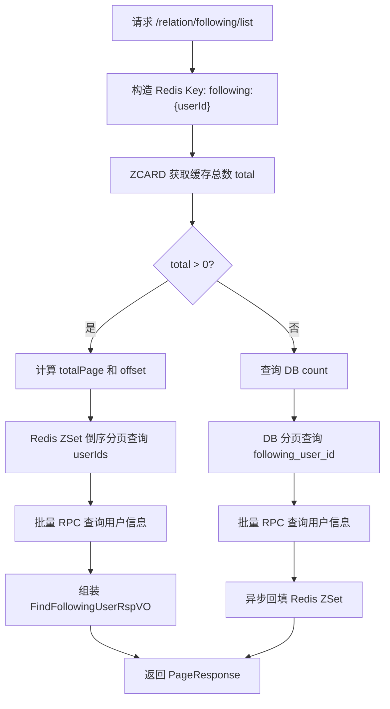
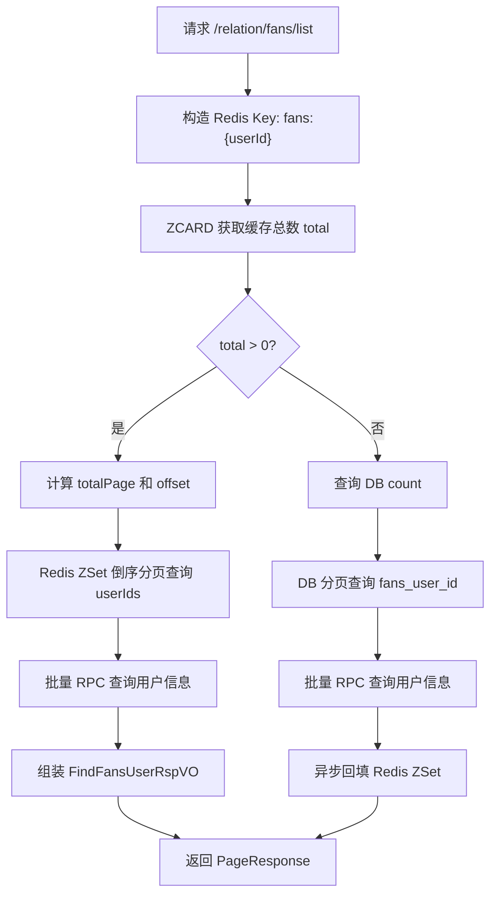

# 用户关系服务关注列表与粉丝列表查询实现梳理

## 1. 代码位置

用户关系服务对应模块：

```text
xiaohashu-user-relation/xiaohashu-user-relation-biz
```

核心入口：

```text
controller/RelationController.java
service/impl/RelationServiceImpl.java
```

关注列表相关：

```text
POST /relation/following/list
RelationServiceImpl.findFollowingList(...)
FollowingDOMapper.xml
FindFollowingListReqVO.java
FindFollowingUserRspVO.java
```

粉丝列表相关：

```text
POST /relation/fans/list
RelationServiceImpl.findFansList(...)
FansDOMapper.xml
FindFansListReqVO.java
FindFansUserRspVO.java
```

Redis Key：

```text
following:{userId}
fans:{userId}
```

对应代码：

```text
constant/RedisKeyConstants.java
```

## 2. 数据模型设计

用户关系服务里，关注和粉丝拆成了两张表。

### 2.1 关注表 t_following

从 `FollowingDOMapper.xml` 可以看到主要字段：

```text
id
user_id
following_user_id
create_time
```

含义：

```text
user_id             当前用户
following_user_id   当前用户关注的人
create_time         关注时间
```

比如用户 A 关注了用户 B：

```text
t_following:
user_id = A
following_user_id = B
```

所以查询 A 的关注列表，就是查：

```sql
select following_user_id
from t_following
where user_id = A
order by create_time desc
limit offset, limit
```

### 2.2 粉丝表 t_fans

从 `FansDOMapper.xml` 可以看到主要字段：

```text
id
user_id
fans_user_id
create_time
```

含义：

```text
user_id        被关注的人
fans_user_id   粉丝用户
create_time    关注时间
```

还是用户 A 关注了用户 B：

```text
t_fans:
user_id = B
fans_user_id = A
```

所以查询 B 的粉丝列表，就是查：

```sql
select fans_user_id
from t_fans
where user_id = B
order by create_time desc
limit offset, limit
```

这种双表设计的好处是：关注列表和粉丝列表都可以按 `user_id` 直接查，避免每次反向扫描。

## 3. Redis 缓存结构

关注列表和粉丝列表都使用 Redis ZSet。

### 3.1 关注列表缓存

Key：

```text
following:{userId}
```

Value：

```text
followingUserId
```

Score：

```text
关注时间戳
```

也就是说，一个用户关注的人会被放到一个 ZSet 中，分数是关注时间。查询时按 score 倒序返回，就能得到最近关注的人。

### 3.2 粉丝列表缓存

Key：

```text
fans:{userId}
```

Value：

```text
fansUserId
```

Score：

```text
关注时间戳
```

粉丝列表也是一样，用关注时间作为 score，查询时按时间倒序分页。

### 3.3 为什么用 ZSet

这里不用 List 或 Set，而用 ZSet，主要是因为：

1. 需要按关注时间倒序展示。
2. 需要分页查询。
3. 需要支持新增、删除关系。

ZSet 同时满足排序和分页：

```java
redisTemplate.opsForZSet()
    .reverseRangeByScore(key, Double.NEGATIVE_INFINITY, Double.POSITIVE_INFINITY, offset, limit);
```

## 4. 查询关注列表 findFollowingList

入口方法：

```java
RelationServiceImpl.findFollowingList(FindFollowingListReqVO req)
```

请求参数：

```text
userId
pageNo
```

返回对象：

```text
FindFollowingUserRspVO
```

字段包括：

```text
userId
avatar
nickname
introduction
```

### 4.1 整体流程



### 4.2 Redis 命中逻辑

先构造关注列表缓存 Key：

```java
String followingListRedisKey = RedisKeyConstants.buildUserFollowingKey(userId);
```

底层就是：

```java
return "following:" + userId;
```

然后通过 `zCard` 获取 ZSet 总数量：

```java
long total = redisTemplate.opsForZSet().zCard(followingListRedisKey);
```

如果 `total > 0`，说明 Redis 中有关注列表缓存。

接着计算总页数：

```java
long totalPage = PageResponse.getTotalPage(total, limit);
```

每页固定 10 条：

```java
long limit = 10;
```

如果请求页码超过总页数，直接返回空列表：

```java
if (pageNo > totalPage) {
    return PageResponse.success(null, pageNo, total);
}
```

计算 offset：

```java
long offset = PageResponse.getOffset(pageNo, limit);
```

从 Redis ZSet 中按 score 倒序分页取关注用户 ID：

```java
Set<Object> followingUserIdsSet = redisTemplate.opsForZSet()
    .reverseRangeByScore(
        followingListRedisKey,
        Double.NEGATIVE_INFINITY,
        Double.POSITIVE_INFINITY,
        offset,
        limit
    );
```

这里 `reverseRangeByScore` 等价于按 score 从高到低取，score 是关注时间戳，所以返回的是最近关注的人。

拿到 ID 后，转成 `List<Long>`：

```java
List<Long> userIds = followingUserIdsSet.stream() 
    .map(object -> Long.valueOf(object.toString()))
    .toList();
```

然后批量调用用户服务：

```java
findFollowingUserRspVOS = rpcUserServiceAndDTO2VO(userIds, findFollowingUserRspVOS);
```

内部实际调用：

```java
userRpcService.findByIds(userIds);
```

再把用户服务返回的 DTO 转成关注列表 VO：

```java
FindFollowingUserRspVO.builder()
    .userId(dto.getId())
    .avatar(dto.getAvatar())
    .nickname(dto.getNickName())
    .introduction(dto.getIntroduction())
    .build()
```

### 4.3 Redis 未命中逻辑

如果 Redis 的 `zCard` 返回 0，则认为缓存没有数据，走 DB 查询。

先查总数：

```java
long count = followingDOMapper.selectCountByUserId(userId);
```

SQL：

```sql
select count(1)
from t_following
where user_id = #{userId}
```

然后计算总页数和 offset：

```java
long totalPage = PageResponse.getTotalPage(count, limit);
long offset = PageResponse.getOffset(pageNo, limit);
```

分页查询关注用户 ID：

```java
List<FollowingDO> followingDOS =
    followingDOMapper.selectPageListByUserId(userId, offset, limit);
```

SQL：

```sql
select following_user_id
from t_following
where user_id = #{userId}
order by create_time desc
limit #{offset}, #{limit}
```

查到关注用户 ID 后，同样批量调用用户服务补全用户信息。

### 4.4 异步回填 Redis

DB 查询成功后，会异步把关注列表同步到 Redis：

```java
threadPoolTaskExecutor.submit(() -> syncFollowingList2Redis(userId));
```

`syncFollowingList2Redis` 的逻辑是：

1. 从 DB 查询该用户最多 1000 个关注关系。
2. 构造 Redis ZSet 参数。
3. 执行 Lua 脚本批量写入 ZSet，并设置过期时间。

DB 查询：

```java
List<FollowingDO> followingDOS = followingDOMapper.selectAllByUserId(userId);
```

SQL：

```sql
select following_user_id, create_time
from t_following
where user_id = #{userId}
limit 1000
```

过期时间：

```java
long expireSeconds = 60 * 60 * 24 + RandomUtil.randomInt(60 * 60 * 24);
```

也就是 1 天保底，再加 0 到 1 天随机时间。这样可以避免大量缓存同一时间过期导致缓存雪崩。

构造 Lua 参数：

```java
Object[] luaArgs = buildLuaArgs(followingDOS, expireSeconds);
```

参数结构是：

```text
score1, value1, score2, value2, ..., expireSeconds
```

其中：

```text
score = create_time 时间戳
value = following_user_id
```

然后执行：

```java
/lua/follow_batch_add_and_expire.lua
```

完成批量写 ZSet 和设置过期时间。

## 5. 查询粉丝列表 findFansList

入口方法：

```java
RelationServiceImpl.findFansList(FindFansListReqVO req)
```

请求参数：

```text
userId
pageNo
```

返回对象：

```text
FindFansUserRspVO
```

字段包括：

```text
userId
avatar
nickname
fansTotal
noteTotal
```

目前 `fansTotal` 和 `noteTotal` 在代码里是 TODO，暂时返回 0：

```java
.noteTotal(0L)
.fansTotal(0L)
```

### 5.1 整体流程



粉丝列表和关注列表的整体结构基本一样，区别主要在 Key、表、字段、缓存数量上。

### 5.2 Redis 命中逻辑

构造粉丝列表 Redis Key：

```java
String fansListRedisKey = RedisKeyConstants.buildUserFansKey(userId);
```

底层是：

```java
return "fans:" + userId;
```

获取缓存总数：

```java
long total = redisTemplate.opsForZSet().zCard(fansListRedisKey);
```

如果 `total > 0`，从 Redis ZSet 分页查询：

```java
Set<Object> followingUserIdsSet = redisTemplate.opsForZSet()
    .reverseRangeByScore(
        fansListRedisKey,
        Double.NEGATIVE_INFINITY,
        Double.POSITIVE_INFINITY,
        offset,
        limit
    );
```

虽然变量名叫 `followingUserIdsSet`，但在粉丝列表里实际存的是 `fansUserId`。

之后转成 `List<Long>`，批量调用用户服务：

```java
findFansUserRspVOS = rpcUserServiceAndCountServiceAndDTO2VO(userIds, findFansUserRspVOS);
```

当前这个方法只调用了用户服务：

```java
List<FindUserByIdRspDTO> findUserByIdRspDTOS = userRpcService.findByIds(userIds);
```

计数服务相关逻辑还没补：

```java
// TODO RPC: 批量查询用户的计数数据
```

### 5.3 Redis 未命中逻辑

缓存没有时，先查 DB 总数：

```java
total = fansDOMapper.selectCountByUserId(userId);
```

SQL：

```sql
select count(1)
from t_fans
where user_id = #{userId}
```

这里有一个保护：

```java
if (pageNo > 500 || pageNo > totalPage) {
    return PageResponse.success(null, pageNo, total);
}
```

也就是说粉丝列表 DB 回源时最多允许查前 500 页。每页 10 条，相当于最多允许通过 DB 直接翻到前 5000 个粉丝。

分页查询：

```java
List<FansDO> fansDOS = fansDOMapper.selectPageListByUserId(userId, offset, limit);
```

SQL：

```sql
select fans_user_id
from t_fans
where user_id = #{userId}
order by create_time desc
limit #{offset}, #{limit}
```

查到粉丝 ID 后，同样批量调用用户服务补全头像、昵称等信息。

### 5.4 异步回填 Redis

DB 查询成功后，会异步同步粉丝列表到 Redis：

```java
threadPoolTaskExecutor.submit(() -> syncFansList2Redis(userId));
```

`syncFansList2Redis` 会从 DB 查询最多 5000 个粉丝：

```java
List<FansDO> fansDOS = fansDOMapper.select5000FansByUserId(userId);
```

SQL：

```sql
select fans_user_id, create_time
from t_fans
where user_id = #{userId}
order by create_time desc
limit 5000
```

然后构造 Lua 参数：

```java
Object[] luaArgs = buildFansZSetLuaArgs(fansDOS, expireSeconds);
```

其中：

```text
score = create_time 时间戳
value = fans_user_id
```

最后执行同一个批量写 ZSet 的 Lua：

```java
/lua/follow_batch_add_and_expire.lua
```

这个 Lua 脚本虽然名字里是 `follow`，但本质是批量 `ZADD + EXPIRE`，所以关注列表和粉丝列表都能复用。

## 6. 关注列表和粉丝列表的区别

| 对比项 | 关注列表 | 粉丝列表 |
| --- | --- | --- |
| 接口 | `/relation/following/list` | `/relation/fans/list` |
| Redis Key | `following:{userId}` | `fans:{userId}` |
| DB 表 | `t_following` | `t_fans` |
| DB 查询字段 | `following_user_id` | `fans_user_id` |
| 缓存 Value | 被关注用户 ID | 粉丝用户 ID |
| 缓存 Score | 关注时间戳 | 关注时间戳 |
| DB 回填 Redis 数量 | 最多 1000 条 | 最多 5000 条 |
| DB 最大翻页限制 | 当前代码未限制 500 页 | 限制前 500 页 |
| 返回字段 | 头像、昵称、简介 | 头像、昵称、粉丝数、笔记数 |

## 7. 为什么粉丝列表只缓存 5000 条

粉丝列表可能远大于关注列表。

普通用户关注别人通常有上限，项目里关注操作的 Lua 也会做关注上限判断；但粉丝数对大 V 来说可能非常大。如果把所有粉丝都放到 Redis，会导致：

1. 单个大 Key 过大。
2. Redis 内存压力高。
3. 同步缓存耗时长。
4. 翻页越深，业务价值越低。

所以项目采用的是“缓存前 N 条热门访问数据”的思路：

```text
关注列表：最多缓存 1000 条
粉丝列表：最多缓存 5000 条
```

粉丝列表 DB 回源时也限制了最多查前 500 页：

```java
pageNo > 500
```

这说明系统不鼓励深分页查询粉丝列表。

## 8. 和关注/取关写链路的关系

虽然这篇文档重点是查询，但查询缓存的正确性和关注/取关写链路有关。

关注时：

1. 当前用户的 `following:{userId}` 会通过 Lua 更新。
2. 发送顺序 MQ。
3. 消费者异步写 `t_following` 和 `t_fans`。

取关时：

1. 当前用户的 `following:{userId}` 会通过 Lua 删除。
2. 发送顺序 MQ。
3. 消费者异步删除 DB 关系。

这里要注意：关注/取关接口主要操作的是“当前用户关注列表”的缓存，粉丝列表缓存的更新更多依赖消费者或后续查询回源同步。读链路本质上接受最终一致。

## 9. 一致性设计

这个查询实现采用的是缓存优先、DB 兜底、异步回填。

优点：

1. 高频访问时大部分请求命中 Redis。
2. ZSet 天然支持按时间排序和分页。
3. DB 只在缓存未命中时兜底。
4. 异步回填不阻塞本次查询响应。

一致性特点：

1. 不是强一致，而是最终一致。
2. 关注/取关后，缓存和 DB 在短时间内可能存在不一致。
3. Redis 设置过期时间，过期后可以从 DB 重新构建。
4. 查询回源后会异步修复缓存。

## 10. 当前实现中值得注意的点

### 10.1 关注列表 DB 回源返回 total 可能有问题

`findFollowingList` 一开始定义：

```java
long total = redisTemplate.opsForZSet().zCard(followingListRedisKey);
```

如果 Redis 未命中，`total` 是 0。随后代码查了 DB 总数：

```java
long count = followingDOMapper.selectCountByUserId(userId);
```

但是最后统一返回：

```java
return PageResponse.success(findFollowingUserRspVOS, pageNo, total);
```

也就是说 DB 回源分支里，最终返回的 total 仍然可能是 Redis 的 0，而不是 DB 查出来的 `count`。

粉丝列表没有这个问题，因为它在 DB 分支里写的是：

```java
total = fansDOMapper.selectCountByUserId(userId);
```

所以如果面试官问到“这段代码有没有可以优化的点”，这是一个可以主动指出的小问题：关注列表 DB 回源时应该把 `count` 赋值给 `total`，或者在返回时使用 `count`。

### 10.2 Redis zCard 为 0 时无法区分“缓存不存在”和“用户确实没有关系”

当前代码用：

```java
total > 0
```

判断是否命中缓存。

如果一个用户确实没有关注任何人，`zCard` 也是 0。这样每次查询都会走 DB。

可以优化为：

1. 使用 `hasKey` 区分 key 是否存在。
2. 对空列表设置一个短 TTL 的空缓存。
3. 或者使用单独标记记录空集合状态。

### 10.3 深分页问题

Redis 分页使用 offset：

```java
reverseRangeByScore(..., offset, limit)
```

DB 分页也使用：

```sql
limit offset, limit
```

当页码很深时，性能会下降。粉丝列表限制了前 500 页，关注列表当前没有类似限制。

更进一步可以考虑基于游标分页：

```text
lastScore + lastUserId
```

这样可以避免深分页 offset 扫描。

### 10.4 粉丝列表返回的计数字段尚未真正接入

`FindFansUserRspVO` 包含：

```text
fansTotal
noteTotal
```

但当前实现里写死为 0：

```java
.noteTotal(0L)
.fansTotal(0L)
```

代码注释也有 TODO，说明后续应该批量调用计数服务补全用户的粉丝数和笔记数。

## 11. 面试回答模板

如果面试官问“你们关注列表和粉丝列表怎么查的”，可以这样回答：

> 我们关系链查询主要是 Redis ZSet + MySQL 兜底。关注列表用 `following:{userId}`，粉丝列表用 `fans:{userId}`，ZSet 的 value 是用户 ID，score 是关注时间戳。查询时先通过 `zCard` 判断缓存是否有数据，如果命中，就用 `reverseRangeByScore` 按关注时间倒序分页拿用户 ID，再批量调用用户服务补全头像、昵称等资料。如果 Redis 没命中，就走 MySQL 分页查询，查到结果后异步把前 N 条关系回填到 Redis，并设置 1 到 2 天的随机过期时间，避免缓存雪崩。

如果继续问“为什么用 ZSet”，可以回答：

> 因为列表需要按关注时间倒序展示，还要支持分页、关注新增和取关删除。ZSet 同时支持 score 排序和范围分页，比普通 Set 或 List 更适合这个场景。

如果问“一致性如何保证”，可以回答：

> 这个场景不要求强一致，采用最终一致。关注/取关写链路先更新 Redis 并发送顺序 MQ 异步落库；查询链路缓存优先，缓存过期或未命中时从 DB 回源并异步重建。短时间内可能有轻微延迟，但换来了更高的读写吞吐。

如果问“有什么优化点”，可以回答：

> 当前实现可以优化几个点：关注列表 DB 回源后 total 返回值应该使用 DB count；空列表可以做短 TTL 空缓存，避免缓存穿透式查 DB；深分页可以改成基于游标的翻页；粉丝列表里的粉丝数和笔记数字段目前 TODO，需要批量接入计数服务。

